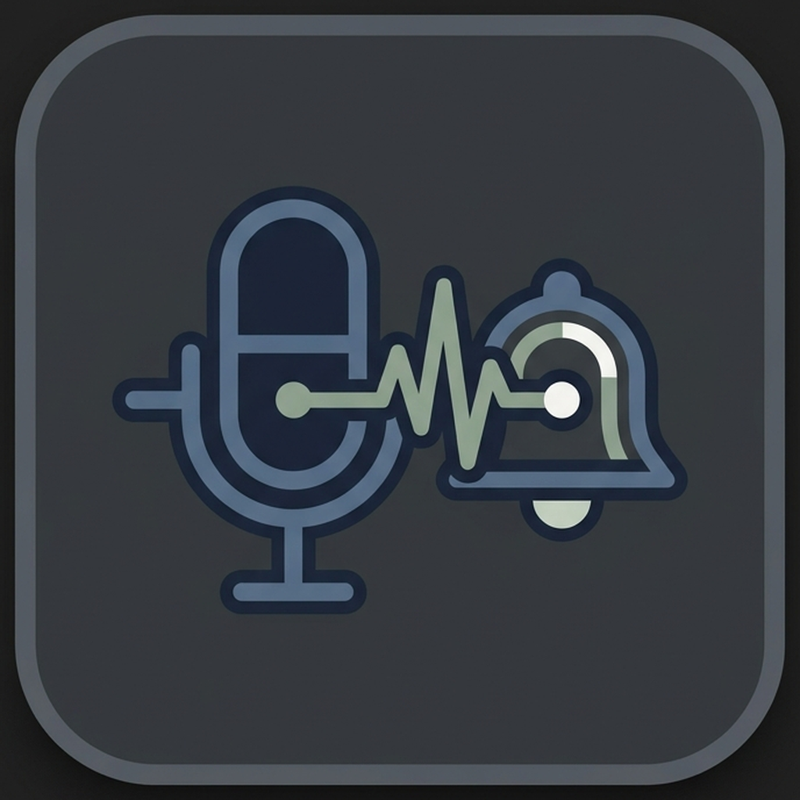

  

<h1 align="center">AI Notifications & Dictation Companion</h1>

  <em>An autonomous notification AI agent harness with long-term memory, MCP tool calling, companion chat, and private local voice dictation.</em>

  
  
  
  

---

## 🎨 Identity & Logo Concept

The **AI Notifications & Dictation** logo captures the unified workflow between voice and notifications:
1. **The Voice Microphone**: Direct acoustic input for private voice dictation and hands-free control.
2. **The Audio Waveform Bridge**: An intelligent soundwave pulse symbolizing real-time AI transcription streaming directly to your local PC over Tailscale.
3. **The Notification Bell**: The alert and smart action harness that listens to incoming messages, schedules alarms, triggers urgent alerts, and logs briefings.

A refined palette of deep charcoal obsidian (`#1F2228`), slate steel blue (`#485D75`), soft sage teal (`#7C998B`), and chalk white was chosen for modern aesthetic clarity—avoiding aggressive neon styling in favor of timeless minimalism.

---

## 🚀 Key Capabilities

- **⚡ Real-Time Notification Processing**: Reads and filters incoming phone notifications via `AiNotificationListenerService`.
- **🧠 Persistent Long-Term Memory**: Injects facts from `memory.md` into prompts across notification triggers and companion conversations.
- **🎙️ Private Voice Dictation**: Speech-to-text streamed securely over Tailscale to your PC running local transcription models, auto-pasted directly into text fields.
- **🛠️ MCP Server & Native Tools**: Supports automated Android alarms, urgent alert vibrations, smart briefings, and remote MCP tool calling.
- **💬 Companion Chat**: Interactive conversational interface to converse with the agent, test scenarios, or manually update memories.

---

## 📂 Assets & Resources

- `assets/logo/logo.png` (or `logo_primary.png`) - Official high-resolution squircle app icon
- `android-app/app/src/main/res/mipmap-*/` - Native Android launcher icons (adaptive & round)
- `android-app/app/src/main/res/drawable/ic_app_logo.png` - In-app branded drawable

---

## 📱 Getting Started with the Android App

See [`android-app/README.md`](android-app/README.md) for full setup instructions, Tailscale configuration, and developer mode guidance.
